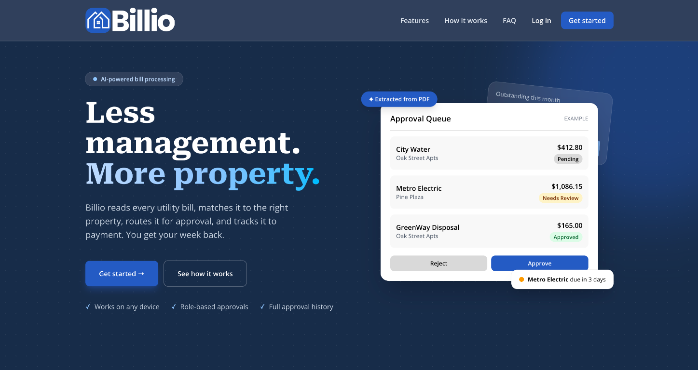
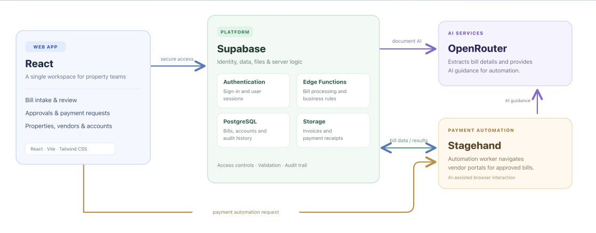
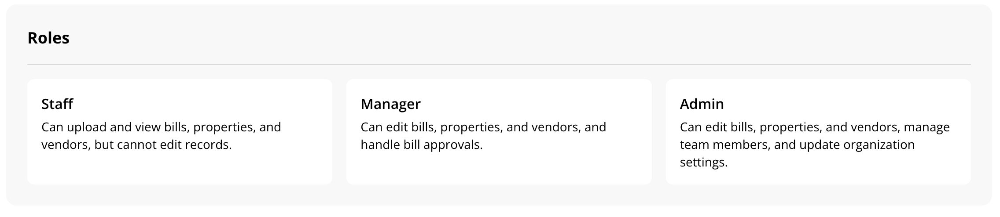
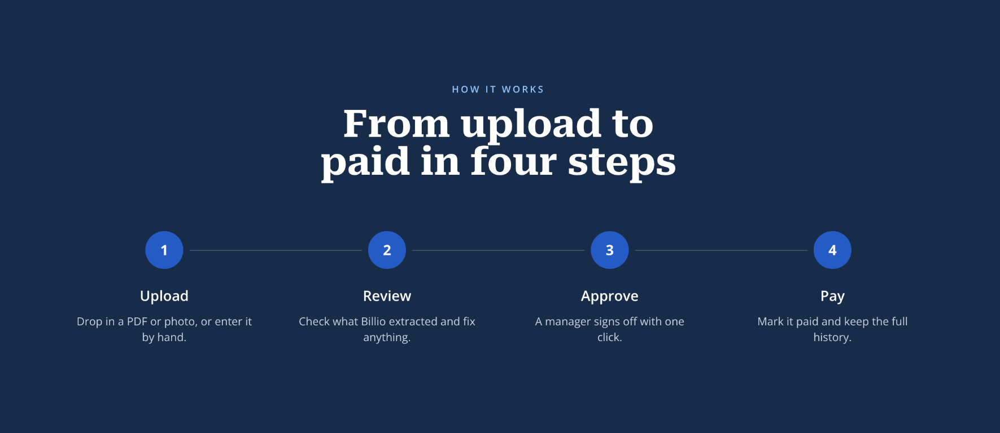

# Billio



> **Problem:** Property management teams need to track bills across many properties. Bill intake, vendor matching, and approval decisions can otherwise become manual and fragmented.
>
> **Solution:** Billio brings property and vendor records, bill entry and upload, AI-assisted extraction, and approval workflows into one application.

## Table of Contents

1. [Introduction](#introduction)
2. [Team](#team)
3. [Technologies Used](#technologies-used)
4. [Architecture Overview](#architecture-overview)
5. [Database Schema](#database-schema)
6. [Authentication Flow](#authentication-flow)
7. [Key Features](#key-features)
8. [API Structure](#api-structure)
9. [Component Structure](#component-structure)
10. [Data Flow](#data-flow)
11. [Deployment](#deployment)
12. [Git Workflow](#git-workflow)
13. [Color Branding](#color-branding)
14. [Useful Commands](#useful-commands)

## Introduction

Billio is a property bill management application for property management teams. It helps users manage properties, vendors, and vendor accounts, enter or upload bills, review extracted details, and route bills through an approval queue.

## Team

| | | |
| :---: | :---: | :---: |
| <br />**Adrian Crosby** | <br />**Aisha Umar** | <br />**Antonio (Tony) Reyes** |
| <br />**Arnau Davis** | <br />**Jake Johnson** | <br />**Sarah Al-Said** |

Also on the team: **Audrey Clark**.

## Technologies Used

<p>
  <a href="https://developer.mozilla.org/en-US/docs/Web/JavaScript"></a>&nbsp;
  <a href="https://react.dev/"></a>&nbsp;
  <a href="https://vite.dev/"></a>&nbsp;
  <a href="https://tailwindcss.com/"></a>&nbsp;
  <a href="https://supabase.com/"></a>&nbsp;
  <a href="https://www.postgresql.org/"></a>&nbsp;
  <a href="https://deno.com/"></a>&nbsp;
  <a href="https://nodejs.org/"></a>&nbsp;
  <a href="https://openrouter.ai/"></a>&nbsp;
  <a href="https://www.stagehand.dev/"></a>
</p>

| Area | Technologies and documentation |
| --- | --- |
| Frontend | [JavaScript](https://developer.mozilla.org/en-US/docs/Web/JavaScript), [React](https://react.dev/), [Vite](https://vite.dev/), [Tailwind CSS](https://tailwindcss.com/docs) |
| Backend and data | [Supabase](https://supabase.com/docs) (Auth, Storage, Edge Functions), [PostgreSQL](https://www.postgresql.org/docs/), [Deno](https://docs.deno.com/) |
| AI-assisted extraction | [OpenRouter](https://openrouter.ai/docs) |
| Payment automation worker | [Node.js](https://nodejs.org/docs/), [Express](https://expressjs.com/), [Stagehand](https://docs.stagehand.dev/) |

## Architecture Overview

The frontend is a React application. Supabase provides authentication, PostgreSQL, file storage, and server-side Edge Functions. An Edge Function uses OpenRouter to extract bill details. A separate worker prototypes browser-based payment automation.



[View the architecture diagram as a PDF](docs/images/billio-architecture-showcase.pdf). The diagram is an MVP overview.

| Component | Description |
| --- | --- |
| Frontend | React application built with Vite and deployed on Vercel |
| Backend | Supabase Edge Functions running on Deno |
| Database | Supabase PostgreSQL |
| Authentication | Supabase Auth |
| File storage | Supabase Storage; bill uploads use the `invoices` bucket |
| Document extraction | OpenRouter called by the `process-bill` Edge Function |
| Payment automation prototype | Node.js/Express bridge and Stagehand worker |

The worker is a prototype, not a production payment service. It can submit payments and uses a service-role key; its bridge has no authentication and permits cross-origin requests. Do not expose it or use real payment credentials. The separate `execute-payment` Edge Function currently creates a simulated confirmation and payment record; it does not execute a vendor-portal payment.

The current payment-method schema includes fields for full card and bank details, including card security codes. Use test data only; the payment implementation is not ready for real financial information or production use.

### Development tools

| Tool | Use |
| --- | --- |
| npm | Frontend dependencies and scripts |
| ESLint | Frontend linting |
| Supabase CLI | Supabase services, migrations, and function deployment |
| Jira | Team task planning and issue tracking |
| Figma | Database schema planning and UI mockups |
| Discord | Main team communication |
| Loom | Demonstrations and walkthroughs |
| Git and GitHub | Source control and team collaboration |

## Database Schema

Supabase PostgreSQL stores the application records. The following tables and fields are referenced by the current application; this is a high-level map, not a complete schema definition.

| Table | Examples of fields used by the app | Purpose |
| --- | --- | --- |
| `user` | `id`, `name`, `role` | Application user details and approval role |
| `organization` | `id`, `name`, `street`, `city`, `state`, `zip`, `phone` | Shared organization settings |
| `property` | `id`, `name`, `status` | Managed properties |
| `vendor` | `id`, `name`, `status` | Vendor records |
| `vendor_account` | `id`, `vendor_id`, `property_id`, `additional_property_ids`, `account_number`, `service`, `payment_type`, `status` | Vendor account with a primary property and optional additional properties |
| `bill` | `id`, `invoice_number`, `amount`, `issue_date`, `due_date`, `status`, `review_reason`, `comments`, `vendor_account_id`, `property_id`, `file_path`, `source` | Bill details and workflow state |
| `audit_trail` | `bill_id`, `user_id`, `action`, `from_status`, `to_status`, `note`, `created_at` | Bill and approval history |
| `payment` | `bill_id`, `amount`, `status`, `method`, `confirmation_number`, `receipt_url` | Payment record and receipt reference |
| `payment_method` | `id`, `org_id`, `type`, `name_on_card`, `expiration_date` | Saved payment-method information |

Incremental database changes are maintained in `supabase/migrations/`. The original base schema for existing tables such as `vendor`, `property`, `bill`, and `user` is not included in the repository; the migrations alone cannot recreate a fresh database. Obtain a compatible baseline from the project maintainers before setting up an isolated database. `supabase/seed.sql` contains sample properties, vendors, and accounts, but no login user.

The account's `property_id` remains the primary property used for manual and
uploaded bills. Active managers and administrators can change it; new bills use
the updated property, while existing bills retain their own property.
Additional properties are informational and do not change bill routing. Remove
an additional property from accounts before deleting that property.

## Authentication Flow

1. A user signs in or registers through the frontend using Supabase Auth.
   Signup creates a matching inactive staff profile linked to the application's
   one organization. The user must verify their email before an administrator
   can activate the account in Account Settings.
2. The Supabase client maintains the user session and attaches the session token to authenticated requests.
3. Edge Functions that require a user validate the request and perform operations using the caller's Supabase context.
4. PostgreSQL Row Level Security policies control which records the authenticated user can read or update.
5. Bill approval decisions are restricted to users with an authorized role by the database approval function.

The application has one organization; administrators can update its details in
Account Settings. Signup fails if the database does not contain exactly one
organization. Before applying the signup migration, review existing Auth
insert triggers, public tables, views, and security-definer functions in the
target database; the migration stops if it finds unreviewed paths that could
conflict or bypass inactive-account restrictions. It protects existing public
tables and the `invoices` bucket; new tables, views, functions, and buckets must
also enforce active status. Existing Auth accounts without a matching app
profile are not backfilled automatically.

Supabase Auth handles email confirmation and password recovery. The repository
includes the email templates in `supabase/templates/confirmation.html` and
`supabase/templates/recovery.html`; password recovery uses a six-digit code.
Signup sends a generic message for new and existing accounts. The confirmation link opens `/confirm-email`, where the
user must click Confirm email before the app verifies the link. The extra click
prevents email link scanners from consuming the confirmation token.

In the Supabase project's Auth settings, configure email
confirmation and SMTP, add each frontend's exact
`/confirm-email` URL to the redirect allowlist, and set the confirmation and
recovery email templates to match `supabase/templates/confirmation.html` and
`supabase/templates/recovery.html`. Set the site URL to
the Vercel frontend. New accounts still need administrator activation
after verification. Deploy the verified-email activation migration and updated
`team-members` Edge Function as well as the frontend; existing inactive users
must verify their email before they can be activated.

Supabase's Auth response for existing accounts depends on project settings and
may reveal account details to direct API callers; the generic frontend message
alone does not guarantee protection from account enumeration. Verify the
deployed Auth responses and consider additional server-side protections if this
is a requirement.

After applying migrations to an isolated test database, the transactional
signup test can be run with
`psql "$DATABASE_URL" -v ON_ERROR_STOP=1 -f supabase/tests/signup_pending_approval.sql`.

### User Roles



## Key Features

### Property and vendor management

- Maintain property and vendor records.
- Associate vendor accounts and services with properties.
- Use property/vendor account relationships when entering bills.

### Bill intake and extraction

- Enter bills manually or upload PDF, JPG, and PNG documents.
- Store uploaded documents in the private `invoices` bucket.
- Extract candidate vendor, account, invoice, amount, and date fields through an Edge Function.
- Match extracted account information to a vendor account when there is one unambiguous match.
- Detect duplicate files and invoices; save incomplete or failed extractions for review.
- Complete or correct saved bill details before approval.

### Review and approval

- Track bills in Pending, Needs Review, Extraction Failed, Approved, Paid, and Rejected states.
- Allow authorized users to approve or reject bills.
- Require a reason when rejecting a bill.
- Record decisions and edits in bill history.

### Accounts and settings

- Sign up, verify email, and reset passwords through Supabase Auth.
- Manage organization details, team roles, account status, and payment methods in settings.

## API Structure

The application uses Supabase Edge Functions and direct Supabase queries/RPCs. Functions are configured in `supabase/config.toml` and implemented under `supabase/functions/`. A separate Express bridge is used by the payment automation prototype.

| Function | Purpose |
| --- | --- |
| `create-bill` | Validate and create a bill |
| `update-bill` | Validate and update an editable bill |
| `process-bill` | Extract, match, check duplicates, and save an uploaded bill |
| `extract-bill`, `match-bill` | Standalone extraction and account-matching functions |
| `read-approvals` | Load bills, approval history, and approval permission |
| `decide-bill` | Record an approval or rejection |
| `create-property`, `update-property`, `delete-property`, `read-properties`, `read-property-details` | Property operations and details |
| `create-vendor`, `update-vendor`, `delete-vendor`, `read-vendors`, `read-vendor-details` | Vendor operations and details |
| `create-vendor-account`, `update-vendor-account` | Vendor account operations |
| `organization-settings`, `team-members` | Organization and team settings |
| `execute-payment` | Simulated payment record; does not execute a real payment |

Shared request validation and helpers live in `supabase/functions/_shared/`. Automated validation tests live in `supabase/functions/tests/`.

## Component Structure

### Layout components

- `AppLayout` — shared authenticated-page layout with sidebar and footer.
- `Sidebar` — primary application navigation.
- `Footer` — shared footer.

### Page components

- `DashboardPage` — application overview.
- `BillsPage` and `BillDetailsPage` — bill list, details, editing, and history.
- `UploadBillPage` — upload, processing, and completion of unfinished bills.
- `ManualBillIntakePage` — manual bill entry.
- `ApprovalsPage` — pending/review queue and approval history.
- `PropertiesPage` and `PropertyDetailsPage` — property list and details.
- `VendorsPage` and `VendorDetailsPage` — vendor and account management.
- `LandingPage` — public landing page.
- `LoginPage`, `ConfirmEmailPage`, `ForgotPasswordPage`, and `AccountSettingsPage` — authentication and settings. Signup is part of `LoginPage`.

### Reusable components and hooks

- `BillDetailsForm` — shared bill input/edit form.
- `UploadDocument` — bill document upload control.
- `FinishBillPanel` — complete bills that need review or whose extraction failed.
- `PropertyForm`, `VendorForm`, and `VendorAccountForm` — property and vendor forms.
- Hooks under `frontend/src/hooks/` — reusable bill, property, vendor, and user-profile data access.
- `frontend/utils/supabase.js` — shared Supabase client.

## Data Flow



### Uploaded bill

1. The user selects a PDF, JPG, or PNG in `UploadDocument`.
2. The file is uploaded to the private Supabase Storage `invoices` bucket.
3. `UploadBillPage` calls `process-bill` with the stored file path.
4. The function downloads the file using the caller's access, checks for a duplicate file, and calls OpenRouter.
5. It matches the extracted account number, checks for a duplicate invoice, and saves the bill as `pending` or `needs_review`. If extraction fails, it saves an `extraction_failed` bill.
6. The page shows the result; users can complete unfinished bills immediately or return to them later.

### Approval decision

1. `read-approvals` returns bills, approval history, and whether the user can approve.
2. An authorized user reviews a bill and approves it or rejects it with a reason.
3. `decide-bill` validates the decision and calls the database function.
4. The bill status and corresponding audit-history row are updated transactionally.

## Deployment

### Supabase

Supabase hosts the PostgreSQL database, Auth, Storage, and Edge Functions. Link the CLI to the intended project before running remote operations:

```bash
npx supabase@latest login
npx supabase@latest link --project-ref YOUR_PROJECT_REF
npx supabase@latest migration list --remote
```

Preview pending migrations before applying them:

```bash
npx supabase@latest db push --dry-run --remote
npx supabase@latest db push --remote
```

Deploy an Edge Function with:

```bash
npx supabase@latest functions deploy FUNCTION_NAME
```

Configure `OPENROUTER_API_KEY` as a secret in the target Supabase project for bill extraction. Review the Auth configuration described above and deploy all functions needed by the frontend, including `process-bill`. Do not put secret keys in frontend environment variables.

### Frontend

The frontend is deployed on Vercel and built with Vite into `frontend/dist/`. Configure `VITE_SUPABASE_URL` and `VITE_SUPABASE_PUBLISHABLE_KEY` for the target project in Vercel. `frontend/vercel.json` provides a single-page-app rewrite.

## Git Workflow

1. Update `main`:
   ```bash
   git switch main
   git pull --ff-only origin main
   ```
2. Create a feature branch:
   ```bash
   git switch -c feature/short-description
   ```
3. Run relevant lint, build, and tests.
4. Stage and commit the files for the change.
5. Push the branch:
   ```bash
   git push -u origin feature/short-description
   ```
6. Open a pull request and request review before merging.

## Color Branding

The shared Tailwind theme is defined in `frontend/src/index.css`.

| Token | Color | Example utilities |
| --- | --- | --- |
| Primary | `#245bc4` | `bg-primary`, `text-primary` |
| Primary hover | `#1e4da6` | `hover:bg-primary-hover` |
| Sidebar | `#182b49` | `bg-sidebar`, `text-sidebar` |
| Sidebar hover | `#2b405d` | `hover:bg-sidebar-hover` |
| Section background | `#f8f8f8` | `bg-section` |
| Secondary | `#d9d9d9` | `bg-secondary` |

Prefer these theme utilities over one-off colors when styling shared UI.

## Useful Commands

Run frontend commands from the repository root:

```bash
npm --prefix frontend run lint
npm --prefix frontend run build
```

Run Edge Function tests from the repository root:

```bash
deno test --node-modules-dir=auto supabase/functions/tests/
```

CI runs the frontend lint/build and Edge Function tests. The SQL signup test described above requires a compatible isolated database.

The optional extraction evaluation under `supabase/evals/` calls OpenRouter and may incur costs; see `supabase/evals/run.js` for its commands and answer-key workflow.
